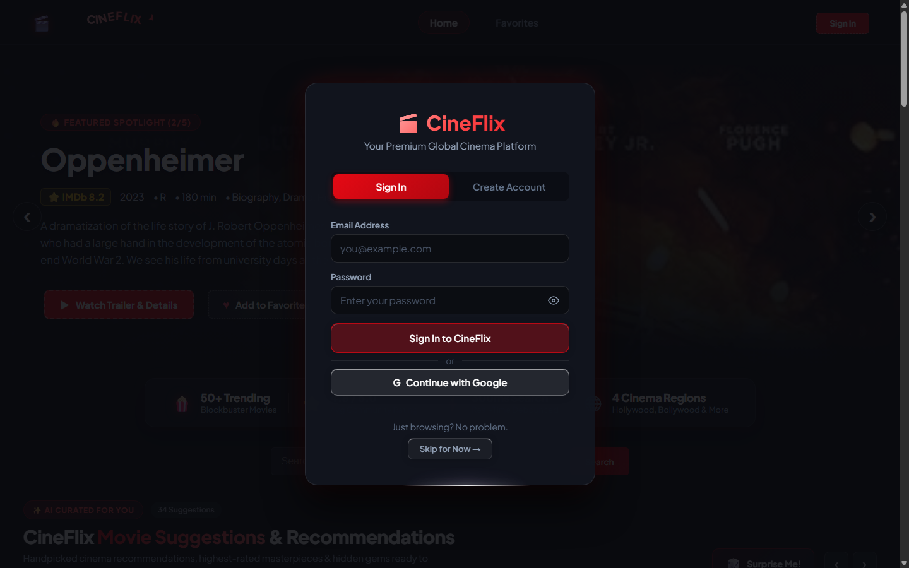
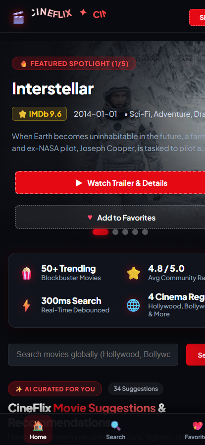
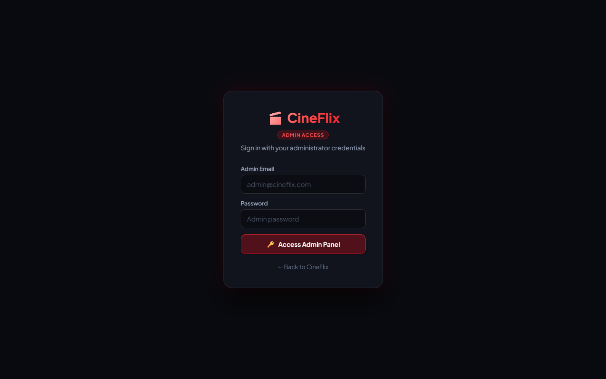
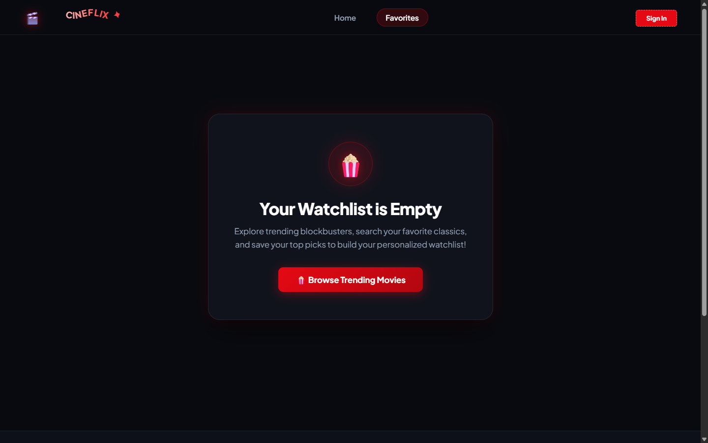

# 🎬 CineFlix — Premium Global Cinema & Recommendation Platform

<p align="center">
  
</p>

<p align="center">
  <strong>A modern, cinematic movie discovery and streaming portal built with React 19, Vite, Supabase, and custom OLED-grade Vanilla CSS Glassmorphism.</strong>
</p>

<p align="center">
  
  
  
  
  
</p>

---

## 📖 About CineFlix

> *"Your Premium Global Cinema Discovery Platform"*

**CineFlix** is a full-stack, cinema-grade movie recommendation and streaming portal designed to solve **decision paralysis** and **discovery fatigue**. 

In the modern streaming era, viewers spend upwards of 18–20 minutes merely scrolling through fragmented catalogs before choosing a film. Popular catalog websites are often cluttered with intrusive ads, sluggish interfaces, or disconnected metadata.

**CineFlix bridges this gap** by bringing world cinema under a single, unified, ad-free umbrella:
- **Global Cinema Curation**: Unified feeds for Hollywood Blockbusters, Bollywood Masterpieces, South Indian Pan-India Hits, K-Dramas, and Japanese Anime.
- **Zero-Redirect Immersion**: Watch high-definition YouTube trailers, inspect IMDb & community ratings, review director and cast credits, and read deep-dive synopses directly within fluid modal overlays without leaving the page.
- **Physics-Based Design System**: Built with an OLED dark aesthetic (`#090a0f`), specular glassmorphism, physics-based 3D cursor tilt tracking (`perspective: 1000px`), and animated light runner card contours.
- **Enterprise-Grade Security**: Defended by an in-memory sliding-window rate limiter, PostgreSQL brute-force locks, RFC-compliant email sanitization, and real-time password complexity scoring.
- **End-to-End Governance**: Features a dedicated back-office administrative CMS allowing moderators to manage films, curate taxonomies, inspect traffic KPIs, and moderate community reviews.

---

## 🌟 Visual Showcase & Screenshots

| 🖥️ Desktop Cinema & Security Modal | 📱 Mobile Responsive View |
| :---: | :---: |
|  |  |
| **Hero Spotlight, 50+ Trending & Auth Gateway** | **Floating Bottom Navigation & Fluid Touch UI** |

| 🛡️ Dedicated Admin Security Gateway | ⭐ User Watchlist & Favorites |
| :---: | :---: |
|  |  |
| **Brute-Force Rate Limiting & Admin Access** | **Cross-Device Persistent Cloud Watchlist** |

---

## ✨ Key Features

- **🎬 Cinematic Hero Spotlight**: Dynamic revolving hero banner showcasing featured blockbusters with direct modal trailer launches and IMDb ratings.
- **🎴 Physics-Based 3D KexsioCards**: Bespoke cards featuring physics-based 3D cursor tilt tracking, specular radial glows, and animated border light runners.
- **⚡ Real-Time Debounced Search**: 300ms intelligent debounced query engine with live TMDB integration and curated local fallback catalogs for 100% uptime.
- **🛡️ Enterprise Security & Brute-Force Rate Limiting**:
  - In-memory sliding-window rate limiter (max 5 attempts with automatic 60-second lockout countdown).
  - PostgreSQL-backed security functions (`check_and_enforce_rate_limit`) with `pgcrypto` bcrypt password hashing.
  - Strict RFC-compliant email validation and 4-tier real-time password strength meter.
- **🔐 Supabase Authentication & Role-Based Access Control (RBAC)**:
  - User profiles with granular permissions (`user` vs `admin`).
  - Route guards (`AdminRoute.jsx`) protecting operational endpoints.
  - Social authentication via Google OAuth and email/password sessions.
- **📊 Comprehensive Back-Office Admin CMS**:
  - **KPI Dashboard**: Real-time traffic, active users, and catalog counts.
  - **Movie Management**: Full CRUD operations and TMDB live sync.
  - **User Governance**: Role promotion/demotion and instant user access suspension.
  - **Review Moderation**: Community review approval, censorship, and deletion.
  - **Platform Settings**: Dynamic site name, branding, and feature flags.
- **📱 Responsive Mobile Experience**: Bottom floating app bar navigation and optimized touch-first layouts.

---

## 🛠️ Tech Stack

| Layer | Technology | Description |
| :--- | :--- | :--- |
| **Frontend** | React 19, React Router v7 | Modern component architecture & client-side routing |
| **Build Tooling** | Vite 8 | Ultra-fast HMR and minified production packaging |
| **Database & Auth** | Supabase (PostgreSQL 15) | Auth sessions, Row-Level Security (RLS) & Edge Functions |
| **Styling** | Vanilla CSS Glassmorphism | Custom CSS animations, 3D tilt geometry, and OLED dark themes |
| **Security** | Custom Rate Limiter + pgcrypto | Brute-force protection, audit logs, and regex validation |
| **APIs** | The Movie Database (TMDB) API | Global movie metadata, posters, and YouTube trailer links |

---

## 📁 Project Structure

```text
MovieRecommender/
├── public/                 # Static assets, SVG icons, and favicon
├── screenshots/            # Showcase images for documentation
│   ├── 01_desktop_showcase.png
│   ├── 02_auth_security.png
│   ├── 03_favorites.png
│   ├── 04_admin_login.png
│   └── 05_mobile_view.png
├── src/
│   ├── assets/             # Logos and graphical resources
│   ├── components/         # Reusable presentation & interactive elements
│   │   ├── AdminFooter.jsx       # Admin layout footer
│   │   ├── AdminHeader.jsx       # Admin breadcrumbs & header
│   │   ├── AdminLayout.jsx       # Wrapper layout for admin portal
│   │   ├── AdminRoute.jsx        # Protected route guard for admin privileges
│   │   ├── AdminSidebar.jsx      # Navigation sidebar for admin back-office
│   │   ├── AuthModal.jsx         # Sign in/up modal with password strength meter
│   │   ├── HeroSpotlight.jsx     # Rotating cinematic hero banner
│   │   ├── HomeSuggestionsRail.jsx # Curated movie recommendation rows
│   │   ├── KexsioCard.jsx        # 3D interactive card with border light runners
│   │   ├── LiquidGlassButton.jsx # Specular glass action button
│   │   ├── MovieCard.jsx         # Movie poster card with hover actions
│   │   ├── MovieModal.jsx        # Movie details, synopsis, cast & YouTube trailer
│   │   ├── NavBar.jsx            # Desktop navbar & search integration
│   │   └── StatsBar.jsx          # Platform metric cards
│   ├── contexts/           # React Context Providers (Auth, Movie, Toast)
│   ├── css/                # Modular Vanilla CSS stylesheets
│   ├── data/               # Curated offline movie catalogs & regional data
│   ├── hooks/              # Custom hooks (`useDebounce`, `useSiteSettings`)
│   ├── lib/                # Supabase client initialization
│   ├── pages/              # Route views (Home, Favorites, Profile, Admin Pages)
│   ├── services/           # TMDB API client & query services
│   └── utils/              # Rate limiter, regex validators, and poster helpers
├── supabase/               # Supabase Edge Functions (`delete-auth-user`)
├── .env.example            # Environment variable template
├── .gitignore              # Git ignore rules (protects secrets & node_modules)
├── package.json            # Dependencies and build scripts
├── supabase_admin_password_setup.sql # Database schema, RLS & security functions
└── vite.config.js          # Vite bundler configuration
```

---

## 🚀 Getting Started

### Prerequisites

Ensure you have the following installed on your machine:
- **Node.js**: v18.0.0 or higher (v20+ recommended)
- **npm** or **yarn** / **pnpm**
- A **Supabase** account ([supabase.com](https://supabase.com))

### 1. Clone the Repository

```bash
git clone https://github.com/Sonu-debug-ui/Movie-Recommendation-Platform.git
cd Movie-Recommendation-Platform
```

### 2. Install Dependencies

```bash
npm install
```

### 3. Environment Variables Setup

Create a `.env` file in the root directory by copying the template:

```bash
cp .env.example .env
```

Open `.env` and fill in your Supabase project credentials:

```env
# Supabase Configuration
# Obtain from: https://supabase.com -> Your Project -> Settings -> API
VITE_SUPABASE_URL=https://your-project-ref.supabase.co
VITE_SUPABASE_ANON_KEY=your-anon-key-here

# TMDB Configuration (Optional / Fallback)
VITE_TMDB_API_KEY=your-tmdb-api-key-here
```

> [!NOTE]
> The app includes offline fallback movie catalogs, so it functions immediately even if TMDB API is not configured!

### 4. Database Setup (Supabase)

1. Open your Supabase Dashboard: `https://supabase.com/dashboard/project/<your-project-ref>`.
2. Navigate to **SQL Editor** → **New Query**.
3. Paste and run the contents of [`supabase_admin_password_setup.sql`](./supabase_admin_password_setup.sql). This provisions:
   - `security_rate_limits` table and enforcement functions.
   - `user_passwords` audit tracking.
   - Secure admin password modification procedures.
4. To grant administrator permissions to an account, run:
   ```sql
   UPDATE public.profiles
   SET role = 'admin'
   WHERE email = 'your-admin-email@example.com';
   ```

### 5. Run Local Development Server

```bash
npm run dev
```

Open [http://localhost:5173](http://localhost:5173) in your browser to experience CineFlix.

---

## 📦 Available Scripts

| Command | Action |
| :--- | :--- |
| `npm run dev` | Starts Vite local development server with fast HMR |
| `npm run build` | Compiles optimized production bundle into `/dist` |
| `npm run preview` | Previews the production build locally on port 4173 |
| `npm run lint` | Runs ESLint analysis across codebase |

---

## 🛡️ Security Architecture

1. **Brute-Force Rate Limiting**: Both frontend (`src/utils/rateLimiter.js`) and database (`security_rate_limits`) enforce progressive back-off after 5 consecutive failed attempts.
2. **Client-Side Secret Isolation**: All sensitive database operations run behind Supabase Row Level Security (RLS) policies. Private environment files are ignored by `.gitignore`.
3. **Password Complexity & Sanitation**: Client-side enforcement requires minimum 8 characters, uppercase, lowercase, numbers, and symbols with live visual feedback.

---

## 🚢 Pushing to GitHub

Follow these steps to push this project to your GitHub account:

```bash
# 1. Initialize or check git status
git status

# 2. Stage all project files
git add .

# 3. Commit the changes
git commit -m "feat: complete CineFlix platform with documentation and screenshots"

# 4. Create a new repository on GitHub (e.g. CineFlix or MovieRecommender)

# Link your local repository to GitHub
git remote add origin https://github.com/Sonu-debug-ui/Movie-Recommendation-Platform.git

# 6. Set main branch and push
git branch -M main
git push -u origin main
```

---

## 📄 License

This project is open-source and distributed under the **MIT License**. Feel free to use, modify, and distribute for personal and educational projects.
